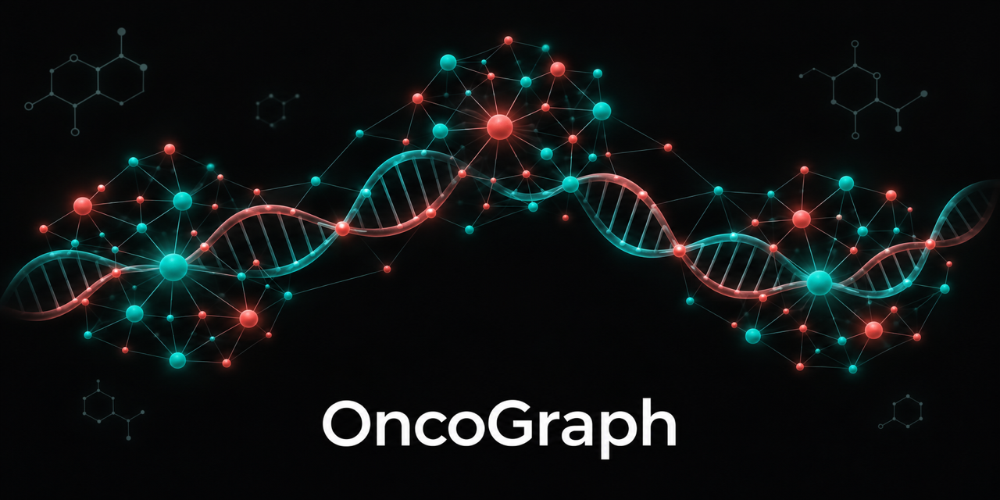

<p align="center">
  
</p>

<p align="center">
  <a href="https://doi.org/10.5281/zenodo.24268992"></a>
  <a href="./LICENSE"></a>
  
  
</p>

Open-source federated cancer data discovery engine. Across 11 packages, OncoGraph indexes 802 cancer types (OncoTree + ICD-O-3), 100+ biomarkers, 66 targeted therapies, and federated API clients for 30+ repositories — returning available datasets, biomarkers, drugs, pathways, survival data, and clinical trials for any query.

## Quick Start

```bash
pnpm add @oncograph/core @oncograph/genomics @oncograph/drugs @oncograph/api
```

```typescript
import { discover, DataRegistry } from "@oncograph/core";
import { gdcRepositories, biomarkers } from "@oncograph/genomics";
import { depMapRepositories, drugs } from "@oncograph/drugs";

const registry = new DataRegistry();
registry.addRepositories([...gdcRepositories, ...depMapRepositories]);
registry.addBiomarkers(biomarkers);
registry.addDrugs(drugs);

const result = discover({
  cancerType: "glioblastoma",
  dataTypes: ["genomic", "imaging", "drug-sensitivity"],
  includeBiomarkers: true,
  includeDrugs: true,
  includePathways: true,
  includeSurvival: true,
}, registry);

// Returns: TCGA, BraTS, IDC collections, DepMap/GDSC sensitivity data,
// IDH1/MGMT biomarkers, temozolomide/bevacizumab,
// RTK-RAS and PI3K-AKT pathways, and 5-year survival curves
```

Start the API server:

```bash
npx @oncograph/api serve --port 3000
```

```bash
curl http://localhost:3000/api/discover?cancerType=NSCLC&includeDrugs=true
```

## What It Does

| Query | Returns |
|-------|---------|
| `cancerType: "glioblastoma"` | TCGA, BraTS, IDC, DepMap; IDH1/MGMT/EGFR/PTEN biomarkers; temozolomide, bevacizumab; RTK-RAS pathway; median survival 14.6 mo |
| `cancerType: "NSCLC", dataTypes: ["drug-sensitivity"]` | DepMap, GDSC, NCI-60; EGFR/ALK/KRAS/ROS1/PD-L1 biomarkers; osimertinib, pembrolizumab, sotorasib; EGFR signaling pathway |
| `cancerType: "breast cancer", dataTypes: ["imaging"]` | TCIA, IDC, CAMELYON; HER2/BRCA1/BRCA2/ER/PR/Ki-67 biomarkers; trastuzumab, olaparib, palbociclib; PI3K-AKT pathway; 5-year survival by subtype |
| `cancerType: "AML"` | TARGET, TCGA, SEER, HTAN; FLT3/NPM1/CEBPA/IDH1/IDH2 biomarkers; midostaurin, gilteritinib, venetoclax; FLT3 signaling pathway |

## Packages

| Package | Description |
|---------|-------------|
| `@oncograph/core` | Cancer taxonomy (802 types, OncoTree + ICD-O-3), registry, discovery query engine, data completeness scoring, FAIR checker |
| `@oncograph/genomics` | 11 repositories (GDC, ICGC, GENIE, cBioPortal, COSMIC, etc.); 104 biomarkers; GDC GraphQL client |
| `@oncograph/imaging` | TCIA, IDC, NLST repositories; 15 collections; IDC API client |
| `@oncograph/drugs` | DepMap, GDSC, NCI-60 + 3 more repositories; 66 targeted therapies; DepMap API client |
| `@oncograph/clinical` | 9 repositories (SEER, UK Biobank, CDA, HTAN, etc.); ClinicalTrials.gov + CDA clients |
| `@oncograph/search` | TF-IDF with field boosting, synonym expansion, 6 entity types |
| `@oncograph/export` | JSON, CSV, Markdown export with FAIR scores and bias annotations |
| `@oncograph/pathways` | 20 KEGG/Reactome cancer signaling pathways, gene-pathway analyzer |
| `@oncograph/survival` | Survival data for 40+ cancer type/biomarker combinations with KM curves |
| `@oncograph/api` | REST API server (Hono) with 10 endpoints + OpenAPI spec |
| `@oncograph/react` | React hooks and components for cancer data UIs |

## Data Sources

**Genomic:** GDC (TCGA, TARGET), ICGC ARGO, AACR GENIE, PCAWG, cBioPortal, COSMIC, ClinVar, GEO, SRA, ENCODE, ArrayExpress
**Imaging:** TCIA (200+ collections), IDC (60M+ DICOM images), NLST, BraTS, LIDC-IDRI, CAMELYON, TCGA Diagnostic Slides
**Drug Sensitivity:** DepMap, GDSC, NCI-60, CCLE, CTD², PharmacoDB
**Clinical:** SEER, UK Biobank, Cancer Data Aggregator, HTAN, ClinicalTrials.gov, ORCID, GDC Clinical, WHO Cancer Mortality, TARGET Clinical
**Pathways:** KEGG, Reactome
**Standards:** mCODE (HL7 FHIR), OncoTree, ICD-O-3, HGNC, GA4GH DRS/Passports

## API Server

OncoGraph ships a standalone REST API server built on Hono with OpenAPI documentation.

```bash
# Start the server
npx @oncograph/api serve --port 3000

# Or from a cloned repo
pnpm --filter @oncograph/api start
```

Example endpoints:

```bash
# Discover datasets for a cancer type
curl http://localhost:3000/api/discover?cancerType=glioblastoma

# List all biomarkers for a cancer type
curl http://localhost:3000/api/biomarkers?cancerType=NSCLC

# Get drug information
curl http://localhost:3000/api/drugs?cancerType=AML

# Retrieve pathway data
curl http://localhost:3000/api/pathways?gene=EGFR

# Survival statistics
curl http://localhost:3000/api/survival?cancerType=breast+cancer&biomarker=HER2

# Search across all entities
curl http://localhost:3000/api/search?q=glioblastoma+IDH1

# OpenAPI spec
curl http://localhost:3000/api/openapi.json
```

## Testing

```bash
pnpm test        # Runs 47 tests across all packages
pnpm test:watch  # Watch mode for development
```

## Authors

- **Ahmed Allem** — University of California, Berkeley
- **Andrea Dykes** — Stanford University
- **Freedom Cheteni-Mandela, PhD** — Stanford University
- **Paulina Valenzuela, MD** — Neural Horizons, Research University

## Development

```bash
git clone https://github.com/kingofmit/oncograph.git
cd oncograph
pnpm install
pnpm build
```

## Disclaimer

OncoGraph provides research data discovery information, not medical advice. All data sources retain their original access requirements, licensing, and citation obligations.

## Support

<a href="https://buymeacoffee.com/kingofmit" target="_blank"></a>

## License

[MIT](./LICENSE) - Ahmed Allem, Andrea Dykes, Freedom Cheteni-Mandela, Paulina Valenzuela
